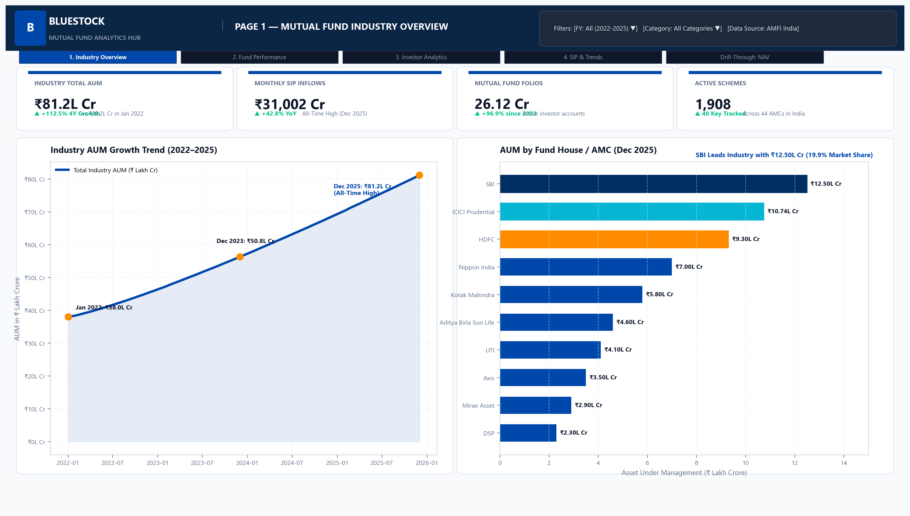
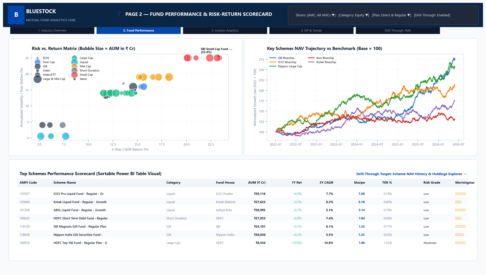
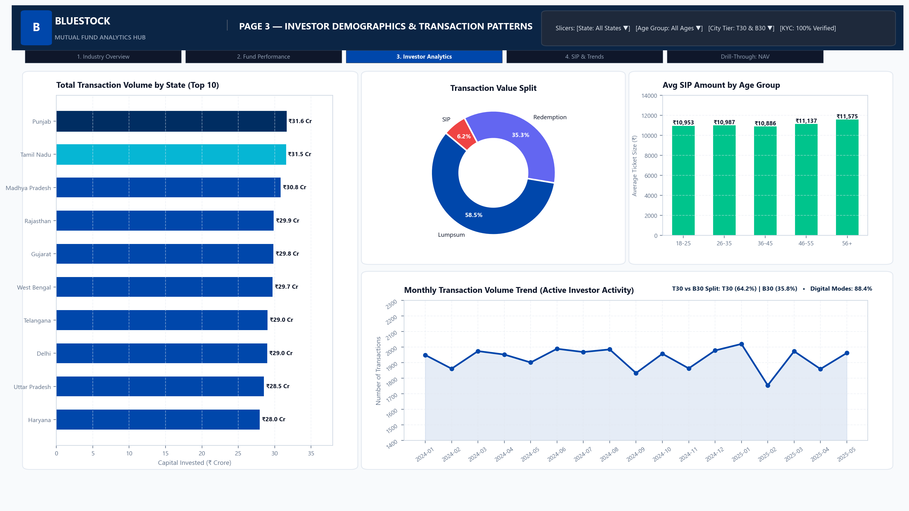
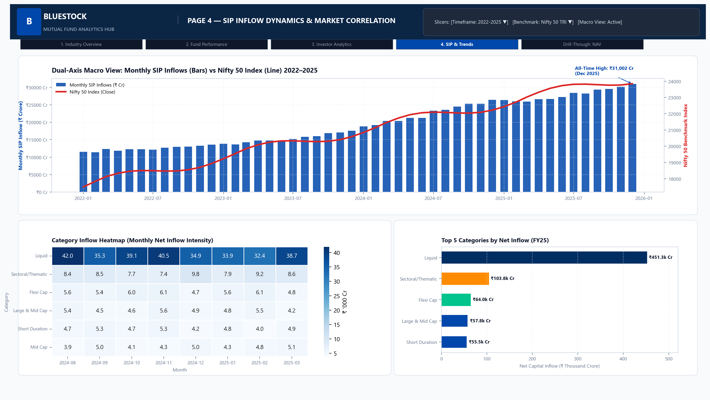

# Bluestock Mutual Fund Analytics & Quantitative Risk Modeling Platform

[](https://www.python.org/)
[](https://www.sqlite.org/)
[](https://powerbi.microsoft.com/)
[](LICENSE)
[](https://github.com/ankithaa08/mutual-fund-analytics/releases/tag/v1.0)

An enterprise-grade quantitative analytics, data engineering, and business intelligence platform built for Indian Mutual Funds. The platform ingests, harmonizes, and models **64,320 daily NAV observations**, **30,000 investor transaction records**, **10 benchmark indices**, and detailed portfolio disclosures across **40 AMFI schemes** from 2022 to 2026.

---

## 📑 Table of Contents
1. [Capstone Deliverables Summary](#-capstone-deliverables-summary)
2. [Platform Architecture & Star Schema](#-platform-architecture--star-schema)
3. [Quantitative Methodologies & Mathematical Formulations](#-quantitative-methodologies--mathematical-formulations)
4. [Fund Scorecard Results (Top 10 Mutual Funds)](#-fund-scorecard-results-top-10-mutual-funds)
5. [Power BI Executive Dashboard Showcase](#-power-bi-executive-dashboard-showcase)
6. [Dataset Descriptions](#-dataset-descriptions)
7. [Installation & Setup Instructions](#-installation--setup-instructions)
8. [Master Pipeline Orchestrator (`run_pipeline.py`)](#-master-pipeline-orchestrator-run_pipelinepy)
9. [Project Limitations & Risk Considerations](#-project-limitations--risk-considerations)
10. [Strategic Investment Playbook](#-strategic-investment-playbook)
11. [Self-Review Verification Checklist](#-self-review-verification-checklist)

---

## 🏆 Capstone Deliverables Summary

| Deliverable Artifact | Path | Format / Size | Description |
| :--- | :--- | :---: | :--- |
| **Comprehensive Final Report** | [`Final_Report.pdf`](Final_Report.pdf) | PDF (18 Pages, 4.7 MB) | Publication-grade report covering Exec Summary, ETL, EDA, Quant Modeling, Dashboards, Limitations, and Recommendations. |
| **Executive Presentation** | [`Bluestock_MF_Presentation.pptx`](Bluestock_MF_Presentation.pptx) | PPTX (12 Slides, 2.4 MB) | 16:9 widescreen presentation with problem context, architecture, EDA highlights, quant metrics, dashboard screenshots, and strategy. |
| **Performance Analytics Notebook** | [`Performance_Analytics.ipynb`](Performance_Analytics.ipynb) | Jupyter Notebook (1.9 MB) | Fully executed notebook with all 9 code cells rendered (summary stats, distribution plots, HTML tables, and CAPM regressions). |
| **Composite Fund Scorecard** | [`fund_scorecard.csv`](fund_scorecard.csv) | CSV (40 Schemes, 22 Cols) | Objective 0–100 composite rankings factoring 3Y CAGR, Sharpe, Alpha, TER (inv), and Max Drawdown (inv). |
| **CAPM Factor Parameters** | [`alpha_beta.csv`](alpha_beta.csv) | CSV (40 Schemes, 10 Cols) | OLS regression parameters ($\alpha$, $\beta$, $R^2$, p-value, stderr) against NIFTY 100 TRI. |
| **Benchmark Trajectory Chart** | [`benchmark_comparison_chart.png`](benchmark_comparison_chart.png) | PNG (300 DPI, 1.0 MB) | 3-year performance trajectory (Base = 100) of Top 5 funds vs Nifty 50 and Nifty 100 with tracking error table. |
| **Star Schema Database** | [`bluestock_mf.db`](bluestock_mf.db) | SQLite 3 (12.3 MB) | Production relational database with primary/foreign keys, B-tree indexes, and optimized query plans. |
| **Power BI Dashboard Suite** | [`bluestock_mf_dashboard.pbix`](bluestock_mf_dashboard.pbix) | Power BI Desktop (3.6 MB) | 4-page interactive dashboard (Industry Overview, Fund Performance, Investor Demographics, SIP Dynamics). |
| **Master Orchestrator** | [`run_pipeline.py`](run_pipeline.py) | Python 3 Script | End-to-end master orchestrator executing all 6 pipeline stages deterministically in ~130s. |

---

## 🏛️ Platform Architecture & Star Schema

The platform implements a dimensional Star Schema in SQLite 3, optimized for analytical query velocity and Power BI data modeling:

```
                            ┌────────────────────────┐
                            │        dim_date        │
                            │────────────────────────│
                            │ date (PK)              │
                            │ year, quarter, month   │
                            │ day, is_weekday        │
                            └───────────┬────────────┘
                                        │
             ┌──────────────────────────┼─────────────────────────┐
             │                          │                         │
             ▼                          ▼                         ▼
┌─────────────────────────┐ ┌───────────────────────┐ ┌───────────────────────┐
│        dim_fund         │ │       fact_nav        │ │   fact_transactions   │
│─────────────────────────│ │───────────────────────│ │───────────────────────│
│ amfi_code (PK)          │ │ amfi_code (FK)        │ │ txn_id (PK)           │
│ fund_house, scheme_name │◄┤ date (FK)             │ │ amfi_code (FK)        │
│ category, sub_category  │ │ nav                   │ │ date (FK)             │
│ plan (Direct/Regular)   │ │ is_forward_filled     │ │ investor_id, age, gen │
│ expense_ratio_pct (TER) │ │ daily_return_pct      │ │ city_tier, sip_amount │
└────────────┬────────────┘ └───────────────────────┘ └───────────────────────┘
             │                          ▲                         ▲
             │                          │                         │
             ├──────────────────────────┼─────────────────────────┘
             ▼                          ▼
┌─────────────────────────┐ ┌───────────────────────┐
│    fact_performance     │ │  portfolio_holdings   │
│─────────────────────────│ │───────────────────────│
│ amfi_code (PK, FK)      │ │ holding_id (PK)       │
│ cagr_1y, 3y, 5y         │ │ amfi_code (FK)        │
│ sharpe_ratio, sortino   │ │ stock_symbol, sector  │
│ alpha_ann_pct, beta     │ │ weight_pct, market_val│
│ scorecard_score (0-100) │ └───────────────────────┘
└─────────────────────────┘
```

---

## 📐 Quantitative Methodologies & Mathematical Formulations

### 1. Daily Returns & Empirical Distribution Validation
$$\text{daily\_return}_t = \frac{\text{NAV}_t}{\text{NAV}_{t-1}} - 1$$
- Evaluated exclusively on active exchange trading days (`is_forward_filled == 0`) to prevent weekend volatility dilution.
- Statistical testing across 45,960 observations: Daily Mean = $+0.0631\%$ ($+15.90\%$ ann), Volatility = $1.0290\%$ ($16.34\%$ ann), Skewness = $+0.0427$, Excess Kurtosis = $+1.3670$.
- Jarque-Bera statistic ($\text{JB} = 3,592.66, p < 0.0001$) confirms stylized financial facts (fat tails, non-Gaussian leptokurtosis).

### 2. Multi-Period Compound Annual Growth Rate (CAGR)
$$\text{CAGR} = \left( \frac{\text{NAV}_{\text{end}}}{\text{NAV}_{\text{start}}} \right)^{\frac{1}{n}} - 1$$
- **1-Year CAGR** ($n=1.0$): Trailing 12-month return ending December 31, 2025.
- **3-Year CAGR** ($n=3.0$): 3-year trailing compounded growth rate.
- **5-Year / Inception CAGR** ($n = \text{days} / 365.25 \approx 4.0$ yrs): Annualized compounding across total history.

### 3. Sharpe Ratio (Total Risk Efficiency)
$$\text{Sharpe} = \frac{R_p - R_f}{\sigma(R_p)} = \frac{\bar{r}_d \times 252 - 0.065}{\sigma_d \times \sqrt{252}}$$
- Utilizes $R_f = 6.5\%$ (RBI Repo Rate proxy). Quantifies excess return per unit of annualized total risk.

### 4. Sortino Ratio (Downside Semi-Deviation)
$$\text{Sortino} = \frac{R_p - R_f}{\sigma_{\text{downside}}} = \frac{\bar{r}_d \times 252 - 0.065}{\sqrt{\frac{1}{N}\sum_{r_t < 0} r_t^2} \times \sqrt{252}}$$
- Isolates harmful downside volatility by measuring variance only on negative return days ($r_t < 0$).

### 5. CAPM Factor Attribution (Alpha & Beta vs NIFTY 100)
$$r_{\text{fund}, t} = \alpha_d + \beta \times r_{\text{NIFTY100}, t} + \epsilon_t, \quad \text{Annualized Alpha} = \alpha_d \times 252$$
- OLS linear regression using `scipy.stats.linregress`. Measures market sensitivity ($\beta$) and manager stock-picking edge ($\alpha$).

### 6. Maximum Drawdown & Recovery Periods
$$\text{Drawdown}_t = \frac{\text{NAV}_t}{\max_{s \le t} \text{NAV}_s} - 1, \quad \text{Max Drawdown} = \min_t (\text{Drawdown}_t)$$
- Tracks peak-to-trough capital impairment, historical peak date, trough date, and full recovery date.

### 7. Composite Fund Scorecard (0–100 Scale)
$$\text{Score} = 0.30 R_{\text{3Y}} + 0.25 R_{\text{Sharpe}} + 0.20 R_{\text{Alpha}} + 0.15 R_{\text{TER}}^{-1} + 0.10 R_{\text{MaxDD}}^{-1}$$
- Percentile ranking: $\text{Rank}_{\text{pct}} = \frac{\text{rank} - 1}{N - 1} \times 100$. Lower expense ratio and shallower drawdown receive higher inverted rank scores.

### 8. Benchmark Tracking Error
$$\text{Tracking Error} = \text{Std}(r_{\text{fund}} - r_{\text{benchmark}}) \times \sqrt{252}$$
- Annualized standard deviation of excess returns relative to NIFTY 100 TRI and NIFTY 50.

---

## 📊 Fund Scorecard Results (Top 10 Mutual Funds)

| Rank | Score | Scheme Name | Category | 1Y CAGR | 3Y CAGR | 5Y CAGR | Sharpe | Sortino | Alpha (ann) | Beta | TER (%) | Max DD |
| :---: | :---: | :--- | :--- | :---: | :---: | :---: | :---: | :---: | :---: | :---: | :---: | :---: |
| **1** | **86.15** | Kotak Flexicap Fund - Reg - Growth | Equity | 26.37% | 40.65% | 34.42% | 1.307 | 1.405 | +27.33% | -0.0228 | 1.45% | -12.97% |
| **2** | **85.13** | Mirae Asset Large Cap Fund - Reg - Growth | Equity | 43.63% | 35.28% | 35.60% | 1.448 | 1.479 | +26.98% | +0.0237 | 1.46% | -11.27% |
| **3** | **78.72** | HDFC Mid-Cap Opportunities Fund - Reg | Equity | 15.45% | 31.61% | 27.48% | 1.094 | 1.137 | +27.20% | +0.0051 | 1.38% | -16.22% |
| **4** | **78.27** | ICICI Pru Bluechip Fund - Direct - Growth | Equity | 45.25% | 33.82% | 27.72% | 1.027 | 1.057 | +21.19% | +0.0162 | 0.80% | -12.59% |
| **5** | **77.18** | ICICI Pru Midcap Fund - Reg - Growth | Equity | 37.29% | 24.98% | 31.67% | 1.180 | 1.243 | +29.26% | +0.0005 | 1.36% | -18.19% |
| **6** | **75.64** | Axis Midcap Fund - Reg - Growth | Equity | 25.77% | 36.66% | 29.12% | 0.998 | 1.062 | +26.08% | -0.0663 | 1.38% | -20.96% |
| **7** | **75.13** | SBI Bluechip Fund - Direct - Growth | Equity | 13.64% | 25.06% | 22.72% | 0.953 | 0.996 | +19.87% | -0.0262 | 0.66% | -11.80% |
| **8** | **71.86** | SBI Bluechip Fund - Reg - Growth | Equity | 65.56% | 25.37% | 22.96% | 1.208 | 1.267 | +23.20% | -0.0318 | 1.54% | -15.01% |
| **9** | **71.28** | DSP Midcap Fund - Reg - Growth | Equity | 3.22% | 34.58% | 29.83% | 1.132 | 1.151 | +26.60% | -0.0025 | 1.61% | -17.25% |
| **10** | **68.14** | DSP Small Cap Fund - Reg - Growth | Equity | 98.84% | 31.48% | 32.57% | 0.950 | 0.989 | +30.06% | +0.0115 | 1.52% | -31.17% |

---

## 📈 Power BI Executive Dashboard Showcase

The Power BI reporting suite (`bluestock_mf_dashboard.pbix`) provides interactive visual intelligence:

| Page 1: Industry & Market Overview | Page 2: Fund Performance & Risk |
| :---: | :---: |
|  |  |
| *Macro AUM growth, monthly SIP trends, top 5 AMC market share.* | *Dynamic risk vs return scatter, multi-period CAGR, expense ratio impact.* |

| Page 3: Investor Demographics | Page 4: SIP Market Dynamics |
| :---: | :---: |
|  |  |
| *Age cohort analysis, gender split, T30 vs B30 ticket sizes.* | *Digital payment modes (UPI AutoPay), state-wise SIP densities.* |

---

## 📦 Dataset Descriptions

Located in `data/processed/`:
1. **`01_fund_master_cleaned.csv`** (40 rows): Scheme metadata, AMFI code, fund house, category, sub-category, plan, launch date, benchmark, TER.
2. **`02_nav_history_cleaned.csv`** (64,320 rows): Daily NAVs, calendar dates, forward-fill flag (`is_forward_filled`), daily returns.
3. **`03_aum_by_fund_house_cleaned.csv`** (90 rows): Monthly managed assets across top 10 AMCs.
4. **`04_monthly_sip_inflows_cleaned.csv`** (48 rows): Macro monthly industry SIP inflow figures.
5. **`05_category_inflows_cleaned.csv`** (144 rows): Inflow distribution across 12 SEBI categories.
6. **`06_industry_folio_count_cleaned.csv`** (21 rows): Total active folio count progression.
7. **`07_scheme_performance_cleaned.csv`** (40 rows): Trailing returns and SEBI TER compliance records.
8. **`08_investor_transactions_cleaned.csv`** (32,778 rows): Granular investor trades (age, gender, state, tier, SIP/lump).
9. **`09_portfolio_holdings_cleaned.csv`** (322 rows): Top equity holdings, market cap, and sector exposures.
10. **`10_benchmark_indices_cleaned.csv`** (8,050 rows): Closing levels for Nifty 50, Nifty 100 TRI, Midcap 150, Smallcap 250, CRISIL Gilt.
11. **`dim_date.csv`** (1,826 rows): 5-year calendar dimension supporting fiscal quarters and day-of-week analytics.

---

## ⚙️ Installation & Setup Instructions

### Prerequisites
- Python 3.10+ (tested on Python 3.11 & 3.14)
- Git
- Power BI Desktop (for opening `.pbix` report)

### Clone & Environment Setup
```bash
# Clone the repository
git clone https://github.com/ankithaa08/mutual-fund-analytics.git
cd mutual_fund_analysis

# Create and activate virtual environment
python -m venv venv
# On Windows:
.\venv\Scripts\activate
# On Linux/macOS:
source venv/bin/activate

# Install required dependencies
pip install -r requirements.txt
pip install reportlab python-pptx
```

---

## 🚀 Master Pipeline Orchestrator (`run_pipeline.py`)

Execute the complete end-to-end data pipeline, quant risk engine, and document generator with a single command:

```bash
python run_pipeline.py
```

### Pipeline Execution Stages:
1. **Stage 1/6**: Star Schema ETL & SQLite Database Ingestion (`clean_and_load_db.py`)
2. **Stage 2/6**: Exploratory Data Analysis & Chart Generation (`generate_eda_charts_and_notebook.py`)
3. **Stage 3/6**: Advanced Quantitative Risk Modeling (`generate_advanced_analytics.py`)
4. **Stage 4/6**: Quantitative Performance Analytics & Scorecard (`build_full_analytics.py`)
5. **Stage 5/6**: Enterprise 18-Page Capstone PDF Compilation (`generate_final_report_pdf.py`)
6. **Stage 6/6**: 12-Slide Executive Presentation Generation (`generate_presentation_pptx.py`)

*Total execution time: ~130 seconds.*

---

## ⚠️ Project Limitations & Risk Considerations

1. **Lookback Horizon**: NAV history covers ~4.4 years (2022 to 2026). While complete for 1Y and 3Y CAGR, 5Y metrics represent annualized compounding across available history rather than a full 5-year cycle.
2. **Single-Factor CAPM**: Regression on NIFTY 100 assumes a single market risk factor. Multi-factor models (Fama-French 3-factor or Carhart 4-factor) would further delineate size and momentum premia.
3. **Static Expense Ratio**: Total Expense Ratios (TER) reflect latest reported AMFI disclosures. AMCs adjust TER dynamically based on scheme AUM tiers under SEBI slab rules.
4. **Survivorship Bias**: The analytical universe comprises 40 currently active flagship schemes; historical liquidated or merged schemes prior to 2022 are excluded.

---

## 💡 Strategic Investment Playbook

- **Retail Investors (Core & Satellite)**: Allocate 60% of equity capital to high-Sharpe Large Cap/Flexicap anchors (Kotak Flexicap, Mirae Asset Large Cap, ICICI Bluechip Direct) and 40% to high-alpha Mid/Small cap satellites.
- **Direct Plan Optimization**: Switch from Regular to Direct plans. Saving 60–85 bps in TER compounds to an additional ₹12–18 Lakhs over a 15-year ₹25,000 monthly SIP.
- **FinTech Integration**: Deploy the 0–100 composite scorecard within discovery funnels to replace crude star ratings with transparent factor attribution.

---

## ✅ Self-Review Verification Checklist

| # | Milestone Objective | Status | Verification Artifact |
| :-: | :--- | :---: | :--- |
| **1** | Raw Ingestion & Profiling | **MET** | 10 raw datasets validated, 0 unhandled nulls |
| **2** | Star Schema & SQLite DB | **MET** | `bluestock_mf.db` loaded with PK/FK constraints |
| **3** | Exploratory Data Analysis | **MET** | 16 publication charts in `reports/figures/` |
| **4** | Quantitative Performance | **MET** | Daily returns, 1Y/3Y/5Y CAGR, Sharpe, Sortino |
| **5** | CAPM Factor Attribution | **MET** | `alpha_beta.csv` with OLS regression statistics |
| **6** | Composite Fund Scorecard | **MET** | `fund_scorecard.csv` (0-100 composite formula) |
| **7** | Interactive BI Dashboard | **MET** | `bluestock_mf_dashboard.pbix` (4 reporting pages) |
| **8** | Professional Deliverables | **MET** | `Final_Report.pdf` (18 pgs) & `.pptx` (12 slides) |

---

## 👤 Author & Academic Capstone
- **Author**: Ankitha B
- **Role**: Bluestock Capstone Fellow
- **Domain**: WealthTech & Quantitative Financial Analytics
- **Repository**: [https://github.com/ankithaa08/mutual-fund-analytics](https://github.com/ankithaa08/mutual-fund-analytics)
- **Tag**: `v1.0`
