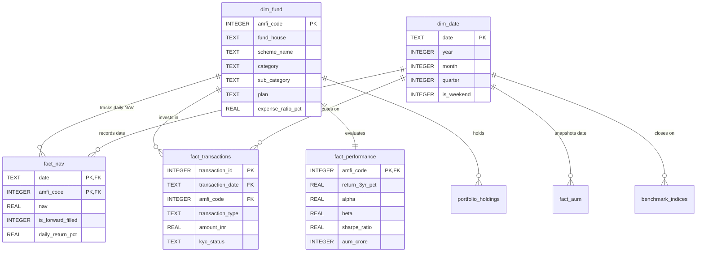

# Bluestock Mutual Fund Analytics Platform - Data Dictionary

**Project**: Mutual Fund Analytics & Engineering Platform (Day 2 Deliverable)  
**Database**: `bluestock_mf.db` (SQLite Star Schema)  
**Storage Engine**: SQLite 3 / SQLAlchemy  
**Source Datasets**: 10 Processed Datasets in `data/processed/`  

---

## 1. Schema Architecture Overview

The database is structured as a **Star Schema** optimized for high-performance financial analytics, reporting, and portfolio risk profiling:

---

## 2. Comprehensive Data Dictionary by Table

### Table 1: `dim_fund` (Fund Master Dimension)
- **Description**: Dimension table containing master metadata, categorization, regulatory classification, and operational parameters for all tracked mutual fund schemes.
- **Source**: `data/processed/01_fund_master_cleaned.csv`
- **Primary Key**: `amfi_code`

| Column Name | SQLite Type | Nullable | Key | Business Definition & Description | Valid Range / Enums |
| :--- | :--- | :---: | :---: | :--- | :--- |
| `amfi_code` | `INTEGER` | No | **PK** | 6-digit unique numerical identifier issued by AMFI. | `100016` – `149324` |
| `fund_house` | `TEXT` | No | — | Name of the Asset Management Company (AMC). | 10 AMCs (e.g., SBI Mutual Fund, HDFC Mutual Fund) |
| `scheme_name` | `TEXT` | No | — | Official registered title of the mutual fund scheme. | Free text string |
| `category` | `TEXT` | No | — | Broad SEBI asset class. | `Equity`, `Debt` |
| `sub_category` | `TEXT` | No | — | Granular SEBI investment category. | `Large Cap`, `Mid Cap`, `Small Cap`, `Liquid`, `Gilt`, etc. |
| `plan` | `TEXT` | No | — | Distribution plan type. | `Direct`, `Regular` |
| `launch_date` | `TEXT` | No | — | Inception / allotment date of the fund (`YYYY-MM-DD`). | `1996-09-11` – `2015-12-28` |
| `benchmark` | `TEXT` | No | — | Official benchmark index tracked for relative performance. | `NIFTY 100 TRI`, `CRISIL Liquid Fund AI`, etc. |
| `expense_ratio_pct` | `REAL` | No | — | Total Expense Ratio (TER) expressed as an annual %. | `0.10%` – `2.50%` |
| `exit_load_pct` | `REAL` | No | — | Redemption fee charged if exited before minimum period. | `0.0%` – `1.0%` |
| `min_sip_amount` | `REAL` | No | — | Minimum allowable monthly SIP contribution in INR. | Typically `₹500.00` |
| `min_lumpsum_amount`| `REAL` | No | — | Minimum initial one-time lumpsum purchase in INR. | `₹100.00` – `₹5,000.00` |
| `fund_manager` | `TEXT` | No | — | Lead portfolio manager overseeing investment strategy. | Free text string |
| `risk_category` | `TEXT` | No | — | SEBI Risk-o-meter rating. | `Low`, `Moderate`, `Moderately High`, `High`, `Very High` |
| `sebi_category_code`| `TEXT` | No | — | Official SEBI taxonomy identifier. | `EC01`, `EC02`, `EC03`, `DC01`, `DC02`, `EI01`, etc. |

---

### Table 2: `dim_date` (Calendar Dimension)
- **Description**: Comprehensive calendar dimension supporting time-intelligence queries, fiscal year reporting, and day-of-week rollups.
- **Source**: `data/processed/dim_date.csv`
- **Primary Key**: `date`

| Column Name | SQLite Type | Nullable | Key | Business Definition & Description | Example Values |
| :--- | :--- | :---: | :---: | :--- | :--- |
| `date` | `TEXT` | No | **PK** | Calendar date in ISO format (`YYYY-MM-DD`). | `2022-01-01` – `2026-12-31` |
| `year` | `INTEGER` | No | — | Calendar year. | `2022` – `2026` |
| `quarter` | `INTEGER` | No | — | Calendar quarter of year (1 to 4). | `1`, `2`, `3`, `4` |
| `month` | `INTEGER` | No | — | Numerical month of year (1 to 12). | `1` – `12` |
| `month_name` | `TEXT` | No | — | Full English month name. | `January`, `February`, etc. |
| `day` | `INTEGER` | No | — | Day of month (1 to 31). | `1` – `31` |
| `day_of_week` | `INTEGER` | No | — | Day of week index (0 = Monday, 6 = Sunday). | `0` – `6` |
| `day_name` | `TEXT` | No | — | Full English day name. | `Monday`, `Tuesday`, etc. |
| `is_weekend` | `INTEGER` | No | — | Weekend binary flag (1 for Saturday/Sunday, 0 for Weekday).| `0`, `1` |
| `fiscal_year` | `TEXT` | No | — | Indian financial fiscal year running April 1 to March 31. | `FY2023-24`, `FY2024-25` |
| `fiscal_quarter` | `TEXT` | No | — | Indian fiscal quarter. | `Q1`, `Q2`, `Q3`, `Q4` |

---

### Table 3: `fact_nav` (Historical Daily NAV Fact)
- **Description**: Daily Net Asset Value time series for all 40 schemes, forward-filled on non-trading days (weekends and public holidays).
- **Source**: `data/processed/02_nav_history_cleaned.csv`
- **Composite Primary Key**: (`amfi_code`, `date`)
- **Foreign Keys**: `amfi_code` ➔ `dim_fund(amfi_code)`, `date` ➔ `dim_date(date)`

| Column Name | SQLite Type | Nullable | Key | Business Definition & Description | Valid Range / Enums |
| :--- | :--- | :---: | :---: | :--- | :--- |
| `date` | `TEXT` | No | **PK, FK** | Historical NAV pricing date (`YYYY-MM-DD`). | `2022-01-03` – `2026-05-29` |
| `amfi_code` | `INTEGER` | No | **PK, FK** | Scheme AMFI code reference. | Foreign key to `dim_fund` |
| `nav` | `REAL` | No | — | Net Asset Value per unit in INR (strictly positive). | `₹10.00` – `₹6,500.00` |
| `is_forward_filled` | `INTEGER` | No | — | Indicator flag: `0` = Actual market trading day, `1` = Forward-filled weekend/holiday. | `0`, `1` |
| `daily_return_pct` | `REAL` | No | — | Day-over-day percentage change in NAV. | Continuous float % |

---

### Table 4: `fact_transactions` (Investor Order Book Fact)
- **Description**: Granular transactional record of investor buy, sell, and systematic investment orders.
- **Source**: `data/processed/08_investor_transactions_cleaned.csv`
- **Primary Key**: `transaction_id`
- **Foreign Keys**: `amfi_code` ➔ `dim_fund(amfi_code)`, `transaction_date` ➔ `dim_date(date)`

| Column Name | SQLite Type | Nullable | Key | Business Definition & Description | Valid Range / Enums |
| :--- | :--- | :---: | :---: | :--- | :--- |
| `transaction_id` | `INTEGER` | No | **PK** | Unique surrogate transaction identifier. | `1` – `32,778` |
| `investor_id` | `TEXT` | No | — | Unique investor identifier. | `INV000001` – `INV005000` |
| `transaction_date` | `TEXT` | No | **FK** | Order settlement date (`YYYY-MM-DD`). | `2024-01-01` – `2025-05-30` |
| `amfi_code` | `INTEGER` | No | **FK** | Scheme AMFI code reference. | Foreign key to `dim_fund` |
| `transaction_type` | `TEXT` | No | — | Standardized transaction mode. | `SIP`, `Lumpsum`, `Redemption` |
| `amount_inr` | `REAL` | No | — | Total transaction monetary value in INR (> 0). | `₹400.00` – `₹5,97,498.00` |
| `state` | `TEXT` | No | — | Indian state of investor residence. | e.g. `Maharashtra`, `Telangana` |
| `city` | `TEXT` | No | — | City of investor residence. | e.g. `Mumbai`, `Hyderabad` |
| `city_tier` | `TEXT` | No | — | AMFI market geography classification. | `T30` (Top 30), `B30` (Beyond 30) |
| `age_group` | `TEXT` | No | — | Demographical age cohort. | `18-25`, `26-35`, `36-45`, `46-55`, `56+` |
| `gender` | `TEXT` | No | — | Investor gender. | `Male`, `Female` |
| `annual_income_lakh`| `REAL` | No | — | Stated annual investor income in INR Lakhs. | `₹3.0` – `₹95.0` Lakhs |
| `payment_mode` | `TEXT` | No | — | Clearing channel utilized. | `UPI`, `Net Banking`, `Mandate`, `Cheque` |
| `kyc_status` | `TEXT` | No | — | SEBI KYC verification state. | `Verified`, `Pending` |

---

### Table 5: `fact_performance` (Scheme Performance & Risk Ratios Fact)
- **Description**: Trailing compound annual returns, risk-adjusted performance metrics, and volatility ratios for all schemes.
- **Source**: `data/processed/07_scheme_performance_cleaned.csv`
- **Primary Key**: `amfi_code`
- **Foreign Key**: `amfi_code` ➔ `dim_fund(amfi_code)`

| Column Name | SQLite Type | Nullable | Key | Business Definition & Description | Valid Range / Enums |
| :--- | :--- | :---: | :---: | :--- | :--- |
| `amfi_code` | `INTEGER` | No | **PK, FK** | Scheme AMFI code reference. | Foreign key to `dim_fund` |
| `scheme_name` | `TEXT` | No | — | Official scheme name. | Free text string |
| `fund_house` | `TEXT` | No | — | Asset Management Company name. | Free text string |
| `category` | `TEXT` | No | — | Scheme category. | `Equity`, `Debt` |
| `plan` | `TEXT` | No | — | Plan variant. | `Regular`, `Direct` |
| `return_1yr_pct` | `REAL` | No | — | 1-Year trailing absolute return (%). | `5.2%` – `38.5%` |
| `return_3yr_pct` | `REAL` | No | — | 3-Year Compound Annual Growth Rate (CAGR %). | `4.8%` – `24.5%` |
| `return_5yr_pct` | `REAL` | No | — | 5-Year Compound Annual Growth Rate (CAGR %). | `4.5%` – `22.0%` |
| `benchmark_3yr_pct` | `REAL` | No | — | Benchmark index 3-year CAGR (%). | `5.1%` – `22.2%` |
| `alpha` | `REAL` | No | — | Jensen's Alpha (excess return generated over benchmark). | `-2.5` to `+6.5` |
| `beta` | `REAL` | No | — | Beta coefficient (sensitivity to benchmark volatility). | `0.1` to `1.35` |
| `sharpe_ratio` | `REAL` | No | — | Sharpe Ratio ((Return - Rf) / Standard Deviation). | `0.80` – `7.68` |
| `sortino_ratio` | `REAL` | No | — | Sortino Ratio (excess return / downside deviation). | `1.10` – `12.40` |
| `std_dev_ann_pct` | `REAL` | No | — | Annualized portfolio volatility (Standard Deviation %). | `1.5%` – `26.0%` |
| `max_drawdown_pct` | `REAL` | No | — | Maximum peak-to-trough historical drop (%). | `-33.5%` to `-2.2%` |
| `aum_crore` | `INTEGER` | No | — | Scheme Assets Under Management in INR Crores. | `₹2,500` – `₹68,500` Cr |
| `expense_ratio_pct` | `REAL` | No | — | Total Expense Ratio (TER %). | `0.55%` – `1.64%` |
| `morningstar_rating`| `INTEGER` | No | — | Morningstar Star Rating. | `1` to `5` |
| `risk_grade` | `TEXT` | No | — | Subjective risk classification grade. | `Low`, `Moderate`, `High`, `Very High` |

---

### Table 6: `fact_aum` (Fund House AUM Fact)
- **Description**: Quarterly snapshots of total Assets Under Management and active scheme counts per AMC.
- **Source**: `data/processed/03_aum_by_fund_house_cleaned.csv`
- **Composite Primary Key**: (`date`, `fund_house`)
- **Foreign Key**: `date` ➔ `dim_date(date)`

| Column Name | SQLite Type | Nullable | Key | Business Definition & Description |
| :--- | :--- | :---: | :---: | :--- |
| `date` | `TEXT` | No | **PK, FK** | Quarter-end snapshot date (`YYYY-MM-DD`). |
| `fund_house` | `TEXT` | No | **PK** | Name of the Asset Management Company. |
| `aum_lakh_crore` | `REAL` | No | — | Total AUM expressed in INR Lakh Crores. |
| `aum_crore` | `INTEGER` | No | — | Total AUM expressed in INR Crores. |
| `num_schemes` | `INTEGER` | No | — | Count of operational mutual fund schemes managed by AMC. |

---

### Table 7: `monthly_sip_inflows` (Supporting Fact)
- **Description**: Monthly industry-level SIP transaction totals, active SIP accounts, and YoY growth.
- **Source**: `data/processed/04_monthly_sip_inflows_cleaned.csv`
- **Primary Key**: `month` (`YYYY-MM`)

| Column Name | SQLite Type | Nullable | Key | Business Definition & Description |
| :--- | :--- | :---: | :---: | :--- |
| `month` | `TEXT` | No | **PK** | Reporting month in format `YYYY-MM`. |
| `sip_inflow_crore` | `INTEGER` | No | — | Gross monthly SIP collection in INR Crores. |
| `active_sip_accounts_crore`| `REAL` | No | — | Total live active SIP investor accounts (Crores). |
| `new_sip_accounts_lakh` | `REAL` | No | — | New SIP accounts registered during the month (Lakhs). |
| `sip_aum_lakh_crore` | `REAL` | No | — | Total AUM accrued through SIP books (INR Lakh Crores). |
| `yoy_growth_pct` | `REAL` | No | — | Year-over-Year growth percentage in monthly SIP collection. |

---

### Table 8: `category_inflows` (Supporting Fact)
- **Description**: Monthly net capital inflows across mutual fund asset categories.
- **Source**: `data/processed/05_category_inflows_cleaned.csv`
- **Composite Primary Key**: (`month`, `category`)

| Column Name | SQLite Type | Nullable | Key | Business Definition & Description |
| :--- | :--- | :---: | :---: | :--- |
| `month` | `TEXT` | No | **PK** | Calendar month of inflow (`YYYY-MM`). |
| `category` | `TEXT` | No | **PK** | Fund category (`Large Cap`, `Mid Cap`, `Liquid`, etc.). |
| `net_inflow_crore` | `REAL` | No | — | Net capital mobilized (Inflow - Outflow) in INR Crores. |

---

### Table 9: `industry_folio_count` (Supporting Fact)
- **Description**: Total and asset-class-wise investor folio counts across the Indian mutual fund industry.
- **Source**: `data/processed/06_industry_folio_count_cleaned.csv`
- **Primary Key**: `month` (`YYYY-MM`)

| Column Name | SQLite Type | Nullable | Key | Business Definition & Description |
| :--- | :--- | :---: | :---: | :--- |
| `month` | `TEXT` | No | **PK** | Month of reporting (`YYYY-MM`). |
| `total_folios_crore` | `REAL` | No | — | Cumulative mutual fund accounts (Folios in Crores). |
| `equity_folios_crore` | `REAL` | No | — | Equity scheme folios (Crores). |
| `debt_folios_crore` | `REAL` | No | — | Debt scheme folios (Crores). |
| `hybrid_folios_crore`| `REAL` | No | — | Hybrid scheme folios (Crores). |
| `others_folios_crore`| `REAL` | No | — | ETFs, Index funds, and FoF folios (Crores). |

---

### Table 10: `portfolio_holdings` (Supporting Fact)
- **Description**: Top 10 underlying stock positions, sector classifications, and portfolio weights for equity schemes.
- **Source**: `data/processed/09_portfolio_holdings_cleaned.csv`
- **Composite Primary Key**: (`amfi_code`, `stock_symbol`)
- **Foreign Key**: `amfi_code` ➔ `dim_fund(amfi_code)`

| Column Name | SQLite Type | Nullable | Key | Business Definition & Description |
| :--- | :--- | :---: | :---: | :--- |
| `amfi_code` | `INTEGER` | No | **PK, FK** | Scheme AMFI code reference. |
| `stock_symbol` | `TEXT` | No | **PK** | NSE ticker symbol (e.g., `RELIANCE`, `HDFCBANK`). |
| `stock_name` | `TEXT` | No | — | Full listed corporate entity name. |
| `sector` | `TEXT` | No | — | Industry sector (Banking, IT, Oil & Gas, etc.). |
| `weight_pct` | `REAL` | No | — | Percentage weight of stock in fund portfolio (0% – 100%). |
| `market_value_cr` | `REAL` | No | — | Monetary value of the fund's stock holding in INR Crores. |
| `current_price_inr` | `REAL` | No | — | Market closing price per equity share in INR. |
| `portfolio_date` | `TEXT` | No | — | Portfolio disclosure date (`YYYY-MM-DD`). |

---

### Table 11: `benchmark_indices` (Supporting Fact)
- **Description**: Historical daily closing values for major Indian market benchmark indices.
- **Source**: `data/processed/10_benchmark_indices_cleaned.csv`
- **Composite Primary Key**: (`date`, `index_name`)
- **Foreign Key**: `date` ➔ `dim_date(date)`

| Column Name | SQLite Type | Nullable | Key | Business Definition & Description |
| :--- | :--- | :---: | :---: | :--- |
| `date` | `TEXT` | No | **PK, FK** | Index valuation date (`YYYY-MM-DD`). |
| `index_name` | `TEXT` | No | **PK** | Benchmark identifier (`NIFTY50`, `NIFTY100`, `CRISIL_LIQUID`). |
| `close_value` | `REAL` | No | — | Daily closing index value points. |

---

## 3. Data Cleaning & Transformation Business Rules Applied

1. **NAV History Calendar Expansion & Forward-Fill**:
   - Reindexed each of the 40 mutual funds against a full calendar daily range (`pd.date_range`).
   - Forward-filled (`.ffill()`) closing NAV values across Saturdays, Sundays, and market holidays.
   - Preserved original trading days while tagging non-trading days via `is_forward_filled = 1`.
   - Verified that all 64,320 resulting records satisfy `NAV > 0`.
2. **Transaction Standardization**:
   - Cleaned `transaction_type` values to standard title-case: `SIP`, `Lumpsum`, `Redemption`.
   - Verified that all transaction values satisfy `amount_inr > 0`.
   - Standardized `kyc_status` into an enforced enumeration: `Verified`, `Pending`.
3. **Performance Metrics Audit**:
   - Cast all returns (`return_1yr_pct`, `return_3yr_pct`, `return_5yr_pct`, `benchmark_3yr_pct`) and risk statistics (`alpha`, `beta`, `sharpe_ratio`, `sortino_ratio`) to numeric floats.
   - Validated that all 40 expense ratios fall within the SEBI regulatory boundary (`0.10%` to `2.50%`).
4. **Relational Integrity Enforcement**:
   - 100% AMFI code alignment verified between dimensions and transactional fact tables.
   - Calendar dimension `dim_date` created spanning 1,826 days (2022 to 2026) to provide a single authoritative time axis.
