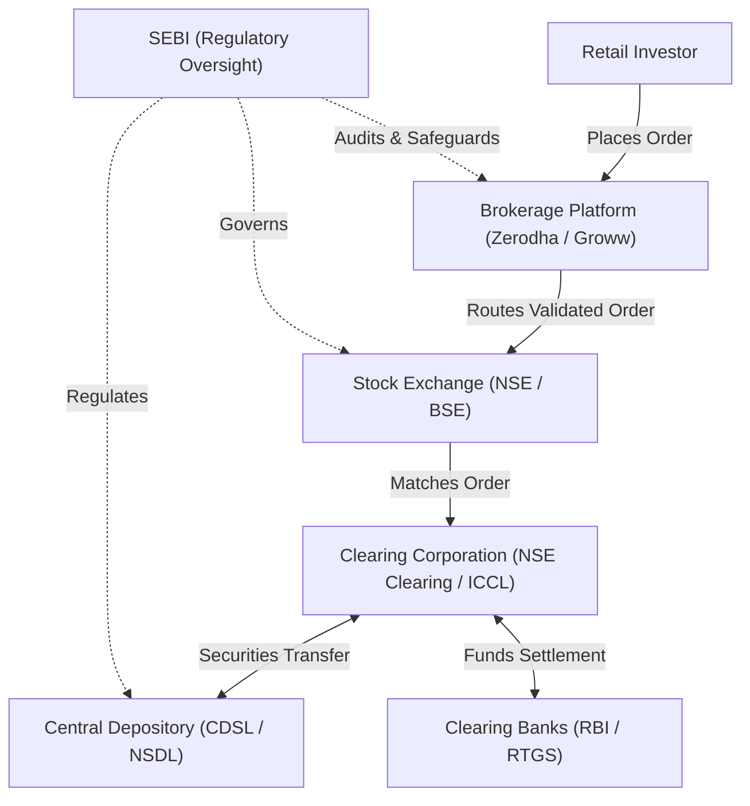
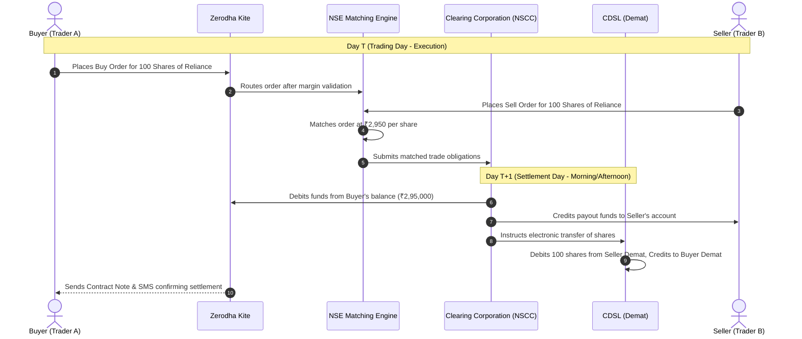

# FinTech Industry Research Report: Market Infrastructure & Data Analytics at Zerodha

**Author**: Data Analytics Engineering Team  
**Module**: Week 2 FinTech Business Understanding  
**Case Study Focus**: Zerodha Broking Limited (Benchmarked against Groww and Indian Capital Markets)  
**Deliverable**: Week 2 FinTech Research Report  

---

## 1. Indian Capital Market Infrastructure & Ecosystem

India's retail capital market has undergone a historic digital revolution, expanding from under 4 crore Demat accounts in 2019 to over **16 crore Demat accounts in 2024**, driven by UPI, Aadhaar e-KYC, and discount brokerages.

### 1. Brokerage Platforms: Discount vs. Full-Service
- **Discount Brokers (Zerodha, Groww, Angel One)**: Charge flat, low-cost fees (e.g., ₹0 for equity delivery, flat ₹20 per trade for intraday/F&O). They provide cutting-edge, tech-first trading platforms without proprietary advisory or relationship managers.
- **Full-Service Brokers (ICICI Direct, HDFC Securities, Kotak Securities)**: Charge percentage-based commissions (0.1% to 0.5% per trade), offering research reports, physical branches, and dedicated wealth managers.

### 2. Demat Account vs. Trading Account vs. Bank Account
The retail investing architecture relies on a seamless three-in-one relationship:
1. **Bank Account**: Holds the investor's fiat currency (INR). Funds are transferred to the broker via UPI, Net Banking, or ASBA.
2. **Trading Account**: Maintained with the broker (e.g. Zerodha). Acts as the financial transactional gateway to execute buy and sell orders on the exchanges.
3. **Demat (Dematerialized) Account**: The electronic repository where securities (equities, mutual funds, ETFs, government bonds) are safely held in digital custody. **Shares are not held by the broker; they reside in national depositories.**

### 3. Depositories in India: NSDL vs. CDSL
India has two central electronic depositories regulated by SEBI:
- **NSDL (National Securities Depository Limited)**: Established in 1996, primarily promoted by the NSE, IDBI, and UTI. Dominates institutional and corporate custody.
- **CDSL (Central Depository Services Limited)**: Established in 1999, promoted by the BSE. Dominates retail Demat accounts (holding over 10 crore accounts) due to aggressive integration with discount brokers like Zerodha and Groww.

### 4. Regulatory Authority: SEBI (Securities and Exchange Board of India)
SEBI acts as the statutory regulator of securities markets, responsible for:
- Protecting the interests of retail investors.
- Mandating **100% upfront margin collection** for intraday and derivatives trading.
- Enforcing strict **T+1 and T+0 settlement cycles**.
- Preventing insider trading, fraudulent pump-and-dump schemes, and unauthorized broker rehypothecation of client funds.

### 5. Market Participants
1. **Retail Investors**: Individual citizens investing personal savings.
2. **High Net Worth Individuals (HNIs)**: Individuals investing capital in excess of ₹2 Crores.
3. **Domestic Institutional Investors (DIIs)**: Indian mutual funds (SBI MF, HDFC MF), insurance corporations (LIC), and pension funds (NPS).
4. **Foreign Portfolio Investors (FPIs / FIIs)**: Global sovereign wealth funds, hedge funds, and foreign institutional entities registered with SEBI.
5. **Authorized Persons / Market Makers**: Institutional liquidity providers matching continuous bid-ask orders.

---

## 2. The Trading & Settlement Lifecycle (T+1 Cycle)

India was the first major global financial market to transition completely to the **T+1 (Trade Date + 1 Business Day) Settlement Cycle** in January 2023, significantly reducing counterparty risk.

---

## 3. Case Study: How Zerodha Uses Data Analytics

**Zerodha Broking Limited** is India's largest bootstrap technology broker, serving over **1.4 crore clients** and contributing over **15% of daily Indian retail trading volume**, with zero external venture capital funding.

### 5 Key Ways Zerodha Leverages Data Analytics:

### 1. Behavioral Analytics & The "Nudge" Feature
- **Problem**: Retail traders frequently blow up accounts by taking emotional, highly leveraged bets in penny stocks or illiquid out-of-the-money (OTM) options.
- **Analytical Solution**: Zerodha engineered **"Nudge"**, a real-time behavioral intervention engine. When an order matches risky behavioral patterns (e.g., buying a stock on the ASM/GSM surveillance list, trading illiquid stock options, or trading with less than 2 days to expiry), a warning modal appears in the UI.
- **Impact**: Internal analytics show that over **30% of retail orders warned by Nudge are voluntarily cancelled by traders**, dramatically curbing reckless trading behavior.

### 2. Real-Time Risk Management & Value-at-Risk (VaR) Engine
- **Problem**: High-volatility market crashes can cause client accounts to plunge into negative balances, exposing the brokerage to multi-crore bad debt liabilities.
- **Analytical Solution**: Zerodha's risk engine processes millions of price ticks per second against portfolio collateral, computing real-time Value-at-Risk (VaR) and margin buffers.
- **Impact**: Automatically triggers phased square-off algorithms the moment a client's margin drops below 80% maintenance threshold, ensuring Zerodha maintained near-zero bad debts even during the historic March 2020 COVID market crash.

### 3. Server Capacity Planning & Peak Volume Modeling
- **Problem**: Stock trading exhibits extreme spikes in activity during market open (9:15 AM – 10:00 AM) and weekly options expiry (Thursdays). Over-provisioning infrastructure is wasteful, while under-provisioning causes system outages.
- **Analytical Solution**: Time-series forecasting models analyze historical tick volumes and volatility indices (India VIX) to auto-scale cloud instances dynamically before volatile market open events.
- **Impact**: Reduced cloud hosting expenses per trade by over **60%**, preserving Zerodha's lean operating model.

### 4. Funnel Analytics & Educational Personalization (Zerodha Varsity)
- **Problem**: First-time investors drop off rapidly if trading interfaces feel overwhelming.
- **Analytical Solution**: Product analysts track granular user journeys, tracking conversion drop-offs from account opening to first trade. Traders exhibiting consistent losses are systematically recommended personalized learning modules on **Zerodha Varsity**.
- **Impact**: Achieved one of the industry's lowest customer acquisition costs (CAC) through organic, education-led user retention.

### 5. Anomaly Detection for Compliance & Fraud Prevention
- **Problem**: SEBI mandates zero tolerance for circular trading, spoofing, and front-running across broker nodes.
- **Analytical Solution**: Graph analytics and outlier detection algorithms continuously scan order execution logs to flag synchronized trading clusters, unusual IP geolocation jumps, and coordinated order pump-and-dumps.
- **Impact**: Seamless regulatory reporting with zero major SEBI punitive penalties.

---

## 4. Summary Takeaways for FinTech Data Analysts

1. **FinTech Analytics is Event-Driven**: Unlike e-commerce, market data changes within milliseconds. Analysts must understand streaming data architectures (WebSockets, Kafka).
2. **Domain Literacy is Mandatory**: Interpreting client metrics requires understanding margin rules, T+1 settlement cycles, and derivative risk profiles.
3. **Analytics Drives Protection as well as Profit**: In financial trading, behavioral nudges and risk management are as critical to enterprise survival as revenue maximization.
