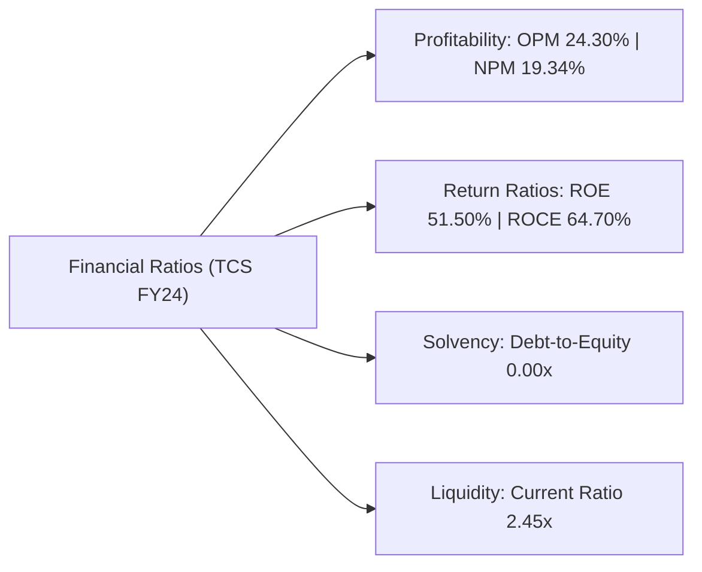

# Financial Statement Analysis: Tata Consultancy Services Ltd (TCS)

**Target Company**: Tata Consultancy Services Limited (NSE: `TCS` | BSE: `532540`)  
**Sector**: Information Technology – Software & Services  
**Analysis Window**: FY 2022, FY 2023, and FY 2024 (Consolidated Figures in INR Crores)  
**Deliverable**: Week 2 Financial Statement Analysis Assignment  

---

## 1. Executive Summary & Company Profile

Tata Consultancy Services (TCS) is India's flagship multinational IT consulting and services giant, operating as part of the Tata Group across 55 countries with over 600,000 employees. As an asset-light, cash-generative enterprise with zero long-term debt, TCS represents an ideal benchmark for financial statement modeling.

### Key Market Snapshot
- **Market Capitalization**: ~₹14,50,000 Crores (~$175 Billion USD)
- **Face Value**: ₹1.00 per equity share
- **P/E Ratio**: ~28.5x (vs Sector Median ~31.0x)
- **Dividend Yield**: ~2.6% – 3.0%

---

## 2. Profit & Loss Statement (P&L / Income Statement)

The P&L measures operating revenues, direct operating expenses, overheads, taxes, and ultimate net profitability over a 12-month period.

| Line Item (₹ in Crores) | FY 2021-22 | FY 2022-23 | FY 2023-24 | 3-Year CAGR / Trend |
| :--- | :---: | :---: | :---: | :---: |
| **Revenue from Operations** | ₹1,91,754 | ₹2,25,458 | **₹2,40,893** | **+12.06% CAGR** |
| Employee Benefit Expenses | (₹1,07,495) | (₹1,27,522) | (₹1,37,842) | ~57.2% of Revenue |
| Other Operating Expenses | (₹31,192) | (₹38,771) | (₹39,521) | Stable overheads |
| **Operating Profit (EBITDA)** | ₹53,057 | ₹59,165 | **₹63,530** | Robust operational margin |
| Depreciation & Amortization | (₹4,606) | (₹5,022) | (₹4,985) | Controlled CapEx |
| **Operating Profit (EBIT)** | ₹48,451 | ₹54,143 | **₹58,545** | **+9.92% CAGR** |
| Other Income | ₹4,018 | ₹3,449 | ₹4,043 | High cash yields |
| Finance Costs (Interest) | (₹784) | (₹779) | (₹778) | Negligible lease interest |
| **Profit Before Tax (PBT)** | ₹51,685 | ₹56,813 | **₹61,810** | High conversion |
| Tax Expense | (₹13,238) | (₹14,604) | (₹15,211) | ~24.6% effective tax |
| **Net Profit (PAT / Bottomline)**| **₹38,447** | **₹42,209** | **₹46,599** | **+10.11% CAGR** |
| **Earnings Per Share (EPS in ₹)** | **₹104.75** | **₹115.19** | **₹127.18** | High per-share growth |

---

## 3. Balance Sheet (Assets, Equity & Liabilities)

The Balance Sheet provides a snapshot of TCS's capital structure and liquidity as of March 31, 2024.

| Capital & Obligations (₹ in Crores) | FY 2023 | FY 2024 | Application of Funds (₹ in Crores) | FY 2023 | FY 2024 |
| :--- | :---: | :---: | :--- | :---: | :---: |
| **Shareholder Equity Capital** | ₹366 | ₹366 | Property, Plant & Equipment (PPE) | ₹21,812 | ₹20,950 |
| **Reserves & Surplus** | ₹90,058 | ₹90,127 | Right-of-Use Assets & Intangibles | ₹8,420 | ₹8,110 |
| **Total Net Worth (Equity)** | **₹90,424** | **₹90,493** | Other Non-Current Assets | ₹11,350 | ₹12,410 |
| Long-Term Borrowings | ₹0 | **₹0** | **Total Non-Current Assets** | **₹41,582** | **₹41,470** |
| Lease Liabilities | ₹7,680 | ₹7,540 | Trade Receivables (Debtors) | ₹41,810 | ₹44,215 |
| Other Non-Current Liabilities | ₹2,950 | ₹3,120 | **Cash & Cash Equivalents + Investments** | **₹49,850** | **₹54,180** |
| Trade Payables (Creditors) | ₹9,120 | ₹9,480 | Other Current Assets | ₹10,488 | ₹11,260 |
| Current Liabilities & Provisions | ₹33,646 | ₹35,492 | **Total Current Assets** | **₹1,02,148**| **₹1,09,655**|
| **Total Liabilities & Equity** | **₹1,43,730**| **₹1,51,125**| **Total Assets** | **₹1,43,730**| **₹1,51,125**|

---

## 4. Cash Flow Statement (CFO, CFI, CFF & Free Cash Flow)

The Cash Flow Statement proves the quality of reported accounting profits by tracking cash inflows and outflows.

| Cash Flow Dimension (₹ in Crores) | FY 2022 | FY 2023 | FY 2024 | Strategic Insights |
| :--- | :---: | :---: | :---: | :--- |
| **Cash Flow from Operating Activities (CFO)** | **₹39,949** | **₹41,965** | **₹48,967** | **105.1% PAT-to-CFO conversion**, proving zero revenue inflation. |
| Capital Expenditures (CapEx) | (₹3,020) | (₹3,180) | (₹3,010) | Lean asset-light operational footprint. |
| **Free Cash Flow (FCF = CFO - CapEx)** | **₹36,929** | **₹38,785** | **₹45,957** | Phenomenal discretionary surplus cash generation. |
| Cash Flow from Investing Activities (CFI) | (₹3,850) | (₹4,120) | (₹3,420) | Surplus invested in high-grade liquid bonds. |
| Cash Flow from Financing Activities (CFF) | (₹35,120) | (₹37,845) | (₹45,547) | **Massive capital return to shareholders** via buybacks and dividends. |
| **Net Change in Cash Position** | **+₹979** | **-₹0** | **-₹0** | Cash balance held optimal at ~₹54,000 Cr. |

---

## 5. Comprehensive Financial Ratio Analysis

### 1. Operating Profit Margin (OPM %)
$$\text{OPM} = \frac{\text{Operating Profit (EBIT)}}{\text{Revenue from Operations}} \times 100 = \frac{₹58,545}{₹2,40,893} \times 100 = \mathbf{24.30\%}$$
- **Industry Context**: Industry-leading profitability driven by premium delivery and strict utilization control.

### 2. Net Profit Margin (NPM %)
$$\text{NPM} = \frac{\text{PAT}}{\text{Revenue}} \times 100 = \frac{₹46,599}{₹2,40,893} \times 100 = \mathbf{19.34\%}$$
- **Analysis**: TCS retains nearly ₹20 of pure cash profit on every ₹100 billed globally.

### 3. Return on Equity (ROE %)
$$\text{ROE} = \frac{\text{Net Profit (PAT)}}{\text{Shareholders' Equity}} \times 100 = \frac{₹46,599}{₹90,493} \times 100 = \mathbf{51.50\%}$$
- **Analysis**: Extremely high ROE (>50%) achieved without financial leverage, driven by continuous capital return through share buybacks and dividends.

### 4. Return on Capital Employed (ROCE %)
$$\text{ROCE} = \frac{\text{EBIT}}{\text{Total Assets} - \text{Current Liabilities}} \times 100 = \frac{₹58,545}{₹1,51,125 - ₹44,972} \times 100 = \mathbf{64.70\%}$$
- **Analysis**: Exceptional return on deployed capital, outperforming global peers (Accenture, Infosys, Cognizant).

### 5. Debt-to-Equity Ratio
$$\text{Debt-to-Equity} = \frac{\text{Total Debt}}{\text{Total Equity}} = \frac{₹0}{₹90,493} = \mathbf{0.00x}$$
- **Analysis**: Pristine balance sheet with zero formal debt; resilient to interest rate tightening cycles.

### 6. Current Ratio (Liquidity)
$$\text{Current Ratio} = \frac{\text{Current Assets}}{\text{Current Liabilities}} = \frac{₹1,09,655}{₹44,972} = \mathbf{2.44x}$$
- **Analysis**: Current assets cover short-term liabilities by almost 2.5x, confirming supreme solvency.

---

## 6. Data Analyst Insights & Investment Verdict

1. **Earnings Quality Score: Exceptional (10/10)**:
   Over 100% of reported PAT converts into operational cash flow, eliminating any risk of aggressive revenue recognition or uncollected receivables.
2. **Generous Shareholder Yield**:
   TCS distributes nearly 80% to 90% of free cash flow annually through regular quarterly dividends and tactical share buybacks.
3. **Valuation Assessment**:
   Trading at ~28x P/E, TCS trades at a premium to broader indices, entirely justified by its 50%+ ROE, zero debt, and multi-billion-dollar recurring enterprise pipeline.
