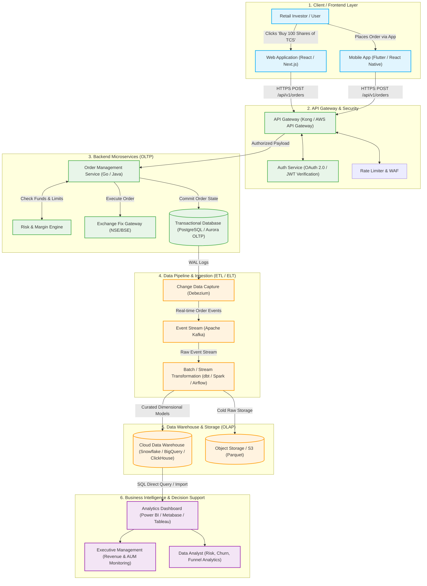
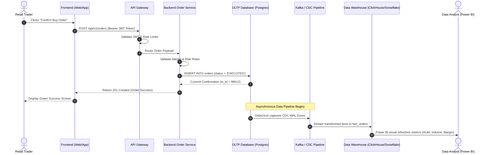

# Software Architecture & Data Flow in FinTech Platforms

**Author**: Data Analytics Engineering Team  
**Module**: Week 2 Software Development Ecosystem & Data Pipelines  
**Deliverable**: Software Architecture Diagram & Technical Guide  

---

## 1. End-to-End Data Flow Architecture

The diagram below illustrates how an event initiated by a retail trader on a mobile app or web browser flows through the backend microservices, persists in operational transactional databases (OLTP), streams into data pipelines, and materializes into business analytics dashboards (OLAP):

---

## 2. Sequence Diagram: Step-by-Step Execution Journey

---

## 3. Core Software Engineering Concepts Explained

### 1. Frontend vs. Backend
- **Frontend (Client-Side)**: The visual, interactive user interface rendered on the user's device (built using React.js, Next.js, Flutter, or Swift). It captures user gestures, performs initial form validation, and renders UI state.
- **Backend (Server-Side)**: The hidden computational engine running in secure cloud environments (built using Python/FastAPI, Go, Java, or Node.js). It enforces core business logic, verifies authentication, calculates trade margins, and interfaces with databases.

### 2. Client–Server Architecture
The architectural paradigm where the **Client** initiates structured requests over the network via standard protocols (HTTP/HTTPS, WebSockets) and the **Server** processes those requests and returns responses (JSON/HTML). This ensures strong security, as secret database keys never touch user devices.

### 3. Authentication & Security
- **OAuth 2.0 & JWT (JSON Web Tokens)**: When a user logs in, the authentication server signs a tamper-proof JWT token. Every subsequent request sends this token in the `Authorization: Bearer <token>` header, verifying identity without repeated password lookups.
- **API Gateway**: Acts as the single entry point, handling SSL termination, DDoS protection, rate limiting, and request routing across internal microservices.

### 4. Databases: OLTP vs. OLAP
| Dimension | OLTP (Online Transaction Processing) | OLAP (Online Analytical Processing) |
| :--- | :--- | :--- |
| **Primary Goal** | High-speed, atomic CRUD operations | Complex aggregations, rollups, and reporting |
| **Typical Systems** | PostgreSQL, MySQL, Amazon Aurora | Snowflake, Google BigQuery, ClickHouse, DuckDB |
| **Data Storage** | Row-oriented (optimal for single-record writes) | Column-oriented (optimal for scanning billions of rows) |
| **Schema Design** | Highly Normalized (3NF to prevent duplicates) | Denormalized (Star / Snowflake Schemas) |
| **FinTech Use Case** | Recording an instantaneous trade execution | Calculating 3-year rolling Sharpe ratios across 10M trades |

### 5. Data Pipelines: Change Data Capture (CDC) & ETL
To prevent analytics queries from slowing down live trading operations, data is continuously synced from OLTP to OLAP:
- **Change Data Capture (CDC)**: Tools like Debezium monitor database transaction write-ahead logs (WAL) and publish change events to **Apache Kafka**.
- **ELT / dbt (Data Build Tool)**: Ingests raw events into the data warehouse and executes scheduled SQL transformations to populate dimensional analytical models.

### 6. Logging, Telemetry & Error Handling
- **Structured Logging**: Services write events in JSON format containing `trace_id`, `user_id`, `timestamp`, and `log_level` (`INFO`, `WARN`, `ERROR`).
- **Telemetry Tools**: Sentry captures unhandled frontend and backend exceptions; the ELK Stack (Elasticsearch, Logstash, Kibana) enables centralized log analytics.

### 7. Software Development Lifecycle (SDLC)
Modern software and data engineering follow Agile SDLC stages:
1. **Requirements & Product Design**: User stories and technical specifications.
2. **Architecture & Schema Design**: Modeling database entities and API contracts.
3. **Implementation**: Writing clean, modular code with automated unit tests.
4. **CI/CD (Continuous Integration / Continuous Deployment)**: GitHub Actions automatically runs tests, linters, and deploys builds to cloud staging environments.
5. **Production Monitoring**: Real-time observability tracking error rates, latency (p99), and pipeline uptime.
