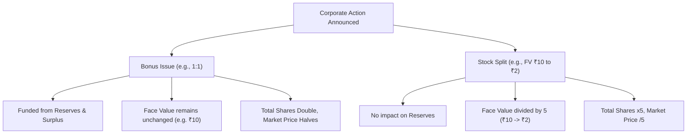

# Stock Market Fundamentals for FinTech Data Analysts

**Author**: Data Analytics Engineering Team  
**Module**: Week 2 Prerequisites & Domain Knowledge  
**Target Domain**: Indian Financial Markets & FinTech Ecosystem  

---

## 1. What is a Stock Market?

A **Stock Market** (or equity market) is a regulated public marketplace where buyers and sellers trade financial instruments—primarily shares of publicly listed companies representing fractional ownership. 

### Primary Market vs. Secondary Market
- **Primary Market**: The venue where companies raise capital directly from the public for the first time by issuing new securities through an **Initial Public Offering (IPO)** or a **Follow-on Public Offering (FPO)**. Money raised goes directly to the company's treasury.
- **Secondary Market**: The continuous marketplace where investors trade previously issued shares amongst themselves (e.g., via Zerodha, Groww, or Angel One on the NSE/BSE). The company receives no capital from these secondary transactions; prices fluctuate strictly based on supply and demand.

---

## 2. Indian Stock Exchanges: NSE & BSE

India operates two primary national stock exchanges regulated by SEBI:

| Feature | National Stock Exchange (NSE) | Bombay Stock Exchange (BSE) |
| :--- | :--- | :--- |
| **Established** | 1992 (Commenced operations in 1994) | 1875 (Asia's oldest stock exchange) |
| **Flagship Benchmark** | **NIFTY 50** | **SENSEX** |
| **Market Share** | ~90%+ of Indian equity derivatives and active cash turnover | Dominant in equity listings (over 5,000+ listed companies) |
| **Trading Platform** | NEAT (National Exchange for Automated Trading) | BOLT (BSE On-Line Trading System) |

---

## 3. Benchmark Indices: Nifty 50 & Sensex

Stock market indices serve as the economic barometer of market health, sectoral trends, and the benchmark against which mutual funds and portfolio managers evaluate performance.

### A. NIFTY 50
- Managed by **NSE Indices Limited**.
- Comprises **50 of the largest, most liquid Indian companies** across 13 sectors listed on the NSE.
- **Weighting Methodology**: Free-Float Market Capitalization.
- *Base Year & Value*: Base year 1995 with a base value of 1,000.

### B. BSE SENSEX (Sensitivity Index)
- Comprises **30 financially sound, well-established blue-chip companies** listed on the BSE.
- Represents over 40% of the total market capitalization of the BSE.
- *Base Year & Value*: Base year 1978–79 with a base value of 100.

---

## 4. IPO vs. SME IPO

| Dimension | Mainboard IPO | SME IPO |
| :--- | :--- | :--- |
| **Platform** | NSE Mainboard / BSE Mainboard | NSE Emerge / BSE SME |
| **Target Companies** | Mature, large-scale enterprises | Small and Medium Enterprises with high growth potential |
| **Minimum Post-Issue Capital** | ₹10 Crores (typically much higher) | Up to ₹25 Crores |
| **Minimum Application Ticket** | ~₹14,000 – ₹15,000 (1 Retail Lot) | ~₹1,00,000 – ₹1,25,000 (Enforced High Lot Size) |
| **Underwriting** | Track-record driven, syndicate underwriting | **100% Mandatory Merchant Banker Underwriting** |
| **Regulatory Filing** | Filed with SEBI for approval | Filed directly with the Stock Exchange |

---

## 5. Market Capitalization (Market Cap)

Market Capitalization is the aggregate market value of a company's outstanding equity shares:

$$\text{Market Capitalization} = \text{Current Market Price (CMP)} \times \text{Total Number of Outstanding Shares}$$

### SEBI Market Cap Classification (Categorization Circular)
1. **Large Cap**: Ranked **1st to 100th** by market cap (e.g., Reliance, TCS, HDFC Bank). High stability, lower volatility, mature dividend payers.
2. **Mid Cap**: Ranked **101st to 250th** by market cap (e.g., Polycab, Persistent Systems). Balanced blend of growth and operational volatility.
3. **Small Cap**: Ranked **251st onwards** by market cap (e.g., CDSL, Tanla Platforms). High growth potential, elevated risk profile, sensitive to economic cycles.

---

## 6. Key Financial Ratios & Valuation Metrics

### 1. Earnings Per Share (EPS)
$$\text{EPS} = \frac{\text{Net Profit after Tax (PAT)} - \text{Preference Dividends}}{\text{Total Number of Outstanding Common Shares}}$$
- Measures the portion of a company's profit allocated to each individual outstanding share.

### 2. Price-to-Earnings Ratio (P/E Ratio)
$$\text{P/E Ratio} = \frac{\text{Current Market Share Price}}{\text{Earnings Per Share (EPS)}}$$
- **Interpretation**: Indicates how much investors are willing to pay for ₹1 of company earnings. A P/E of 25 means an investor pays ₹25 for every ₹1 of profit. High P/E implies high growth expectations; low P/E may imply undervaluation or fundamental distress.

### 3. Price-to-Book Ratio (P/B Ratio)
$$\text{P/B Ratio} = \frac{\text{Current Market Share Price}}{\text{Book Value Per Share (BVPS)}} = \frac{\text{Market Capitalization}}{\text{Total Assets} - \text{Total Liabilities}}$$
- **Interpretation**: Essential for evaluating financial institutions (Banks, NBFCs) and asset-heavy manufacturing businesses. A P/B < 1 indicates the stock is trading below its liquidation break-even net worth.

### 4. Dividend & Dividend Yield
- **Dividend**: The portion of post-tax profit distributed directly to shareholders in cash.
- **Dividend Yield**: 
  $$\text{Dividend Yield (\%)} = \frac{\text{Dividend Per Share (DPS)}}{\text{Current Market Share Price}} \times 100$$

---

## 7. Corporate Actions: Bonus Shares vs. Stock Splits

Both corporate actions alter the share count and nominal price without changing the company's intrinsic economic value:

### Key Differences:
- **Bonus Issue**: Free additional shares granted to existing shareholders funded by capitalizing the company's **Reserves & Surplus**. The **Face Value** of the stock remains unchanged.
- **Stock Split**: The company divides its existing shares into multiple units to increase liquidity and affordability for retail investors. The **Face Value drops proportionally** (e.g., a 1:5 split reduces Face Value from ₹10 to ₹2).

---

## 8. Trading Volume & Liquidity

- **Trading Volume**: The total number of shares transacted between buyers and sellers during a given trading session.
- **Turnover**: The total monetary value of trades executed ($\sum \text{Volume} \times \text{Traded Price}$).
- **Data Analyst Significance**: High volume confirms price breakout validity, ensures narrow **bid-ask spreads**, and shields quantitative backtests from execution slippage.
